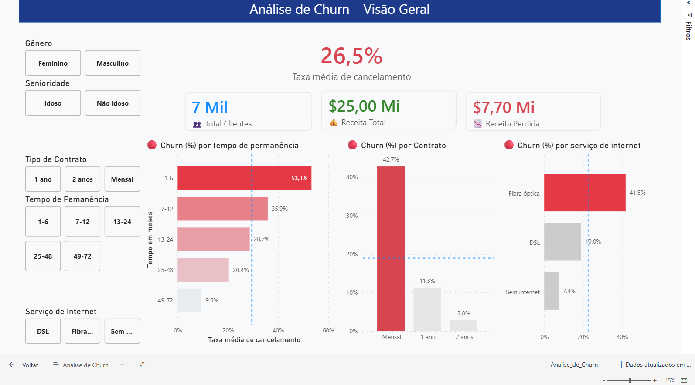

# 📉 Telco Customer Churn Analytics


> **Projeto de Inteligência de Negócios** focado na análise de cancelamento de clientes (Churn). O projeto utiliza Python para tratamento robusto de dados e engenharia de atributos, alimentando um dashboard estratégico no Power BI.

## 📋 Sobre o Projeto

O Churn (taxa de cancelamento) é uma das métricas mais críticas para empresas de telecomunicações. Este projeto visa identificar **quem** está saindo, **por que** estão saindo e **quais padrões** comportamentais antecedem o cancelamento.

A arquitetura do projeto segue um fluxo de ETL (Extract, Transform, Load) onde o Python atua como motor de processamento, entregando dados limpos e enriquecidos para a camada de visualização no Power BI.

<p align="center">
  
</p>

---

## ⚙️ Arquitetura da Solução

O fluxo de dados foi desenhado da seguinte forma:

1.  **Ingestão:** Leitura do dataset bruto `WA_Fn-UseC_-Telco-Customer-Churn.csv`.
2.  **Processamento (Python):** O script `CustomerChurn.py` realiza:
    * Limpeza de dados (tratamento de valores nulos em `TotalCharges`).
    * **Feature Engineering:** Criação de faixas de fidelidade (`tenure_band`) e faixas de gastos (`monthly_band`).
    * **Binarização:** Conversão de variáveis categóricas (Yes/No) para numéricas (1/0) para facilitar medidas DAX.
3.  **Output:** Geração do arquivo `telco_limpo_para_powerbi.csv`.
4.  **Visualização (Power BI):** O arquivo `Analise_de_Churn.pbix` consome o CSV tratado para gerar os gráficos.

---

## 🚀 Funcionalidades do Script Python

O script `CustomerChurn.py` não apenas limpa os dados, mas cria inteligência antes mesmo de chegar no dashboard:

* **Sanitização:** Garante que IDs sejam strings e valores monetários sejam floats.
* **Segmentação Automática:**
    * *Tenure Band:* Agrupa clientes por tempo de casa (ex: "1-12 meses", "13-24 meses").
    * *Service Count:* Contabiliza quantos serviços adicionais (Streaming, Backup, etc.) o cliente possui.
* **Preparação para BI:** Reorganiza colunas priorizando as dimensões mais importantes (IDs, Churn Flag, Valores) para facilitar o "drag-and-drop" no Power BI.

---

## 📊 O Dashboard (Power BI)

O arquivo `Analise_de_Churn.pbix` apresenta uma visão executiva com os seguintes pilares:

### 1. Visão Geral (KPIs)
* Taxa de Churn Global.
* Receita total em risco.
* Ticket Médio (Monthly Charges) dos clientes que saíram vs. ficaram.

### 2. Análise de Perfil
* **Contratos:** Impacto massivo de contratos "Month-to-month" no Churn.
* **Serviços:** Comparação entre DSL vs Fibra Óptica (identificação de problemas técnicos ou de preço na fibra).
* **Pagamentos:** Relação entre "Electronic Check" e altas taxas de saída.

### 3. Fatores de Risco
* Clientes com pouco tempo de casa (Tenure baixo) apresentam maior volatilidade.
* Clientes sem serviços de suporte (Tech Support/Online Security) tendem a cancelar mais.

---

## 🛠️ Tecnologias Utilizadas

* **[Python](https://www.python.org/):** Linguagem principal para manipulação de dados.
* **[Pandas](https://pandas.pydata.org/):** Biblioteca para análise e manipulação de DataFrames.
* **[Power BI](https://powerbi.microsoft.com/):** Ferramenta de visualização e Business Intelligence.
* **[CSV](https://en.wikipedia.org/wiki/Comma-separated_values):** Formato de intercâmbio de dados.

---

## 📦 Como Rodar o Projeto

1.  **Clone o repositório:**
    ```bash
    git clone https://github.com/FarandaMauricio-make/customer-churn-analysis-python-powerbi.git
    cd customer-churn-analysis-python-powerbi
    ```

2.  **Prepare o Ambiente Python:**
    ```bash
    pip install pandas numpy
    ```

3.  **Execute o ETL:**
    O script lê o CSV bruto na mesma pasta em que ele está. Copie o arquivo de `data/raw/` para `python/` e execute:
    ```bash
    cp data/raw/WA_Fn-UseC_-Telco-Customer-Churn.csv python/
    python python/CustomerChurn.py
    ```
    *Isso gerará o arquivo `telco_limpo_para_powerbi.csv` em `python/`. Uma versão já processada está em `data/processed/`.*

4.  **Abra o Dashboard:**
    * Abra o arquivo `powerbi/Analise_de_Churn.pbix` no Power BI Desktop.
    * Caso necessário, atualize a fonte de dados apontando para o novo CSV gerado.

---

## 📂 Estrutura de Arquivos

* `/data/raw`: dataset original (`WA_Fn-UseC_-Telco-Customer-Churn.csv`).
* `/data/processed`: base tratada para o Power BI (`telco_limpo_para_powerbi.csv`).
* `/python`: script `CustomerChurn.py` de limpeza e engenharia de atributos.
* `/powerbi`: arquivo `Analise_de_Churn.pbix`.
* `/imagens`: print do dashboard.

---

## 🤝 Contribuição

Insights sobre correlação ou sugestões de novas métricas DAX?

1.  Faça um Fork.
2.  Crie sua Feature Branch.
3.  Commit e Push.
4.  Abra um Pull Request.

---

## 🎥 Demonstração do Dashboard

[▶ Assista ao vídeo demonstrativo aqui](https://www.youtube.com/watch?v=Xhml2qDakIs)

---

**Dados transformados em Decisões.** 📉
